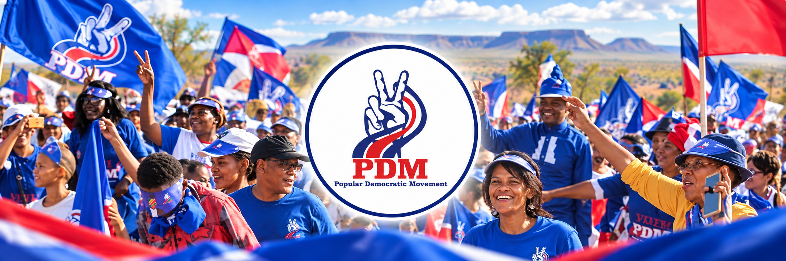
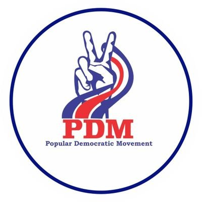
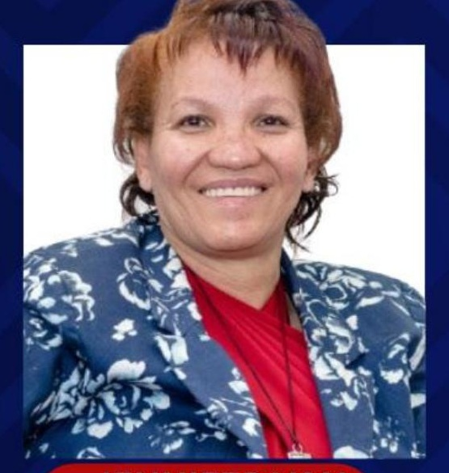

  

  

<h1 align="center">PDM Namibia — National Digital Platform</h1>

  A cinematic public website, installable web app and governed participation platform for Namibia's Popular Democratic Movement.

  <strong><a href="https://pdm-namibia.pages.dev/">Explore the live experience</a></strong>
  &nbsp;·&nbsp;
  <a href="https://freeman-ipumbu.pages.dev/">View Freeman's portfolio</a>
  &nbsp;·&nbsp;
  <a href="https://solarspin-namibia.pages.dev/">SolarSpin Technologies</a>

> **Public case study · 14 October 2026.** This repository documents the product, design system, research and operating model. Production source, private configuration, submissions and staff data remain in a separate private environment. The Pages deployment is a working prototype; PDM must approve a party-owned canonical domain and the launch-governance gates before unrestricted real-data intake.

## The opportunity

Gabriella Stadhauer's original brief named ten essential areas: Home, About PDM, Leadership, News & Media, Policies, Parliamentary Work, Party Structures, Join PDM, Events and Contact. A meeting with PDM President McHenry Venaani widened the question:

**What would it take for a political party's website to become a useful national civic interface rather than a digital brochure?**

The resulting platform brings public information, representation, participation and internal operations into one coherent system. It gives citizens a clear route to understand PDM, find a relevant office or authority, apply for membership, submit an idea, contact the party or register an interest in supporting its work. Behind that public surface is a protected national operations console for handling those journeys responsibly.

The visual brief was equally demanding: no generic colour bands, filler cards or anonymous stock imagery. The experience had to feel unmistakably PDM—confident blue, red and white; documentary scale; editorial typography; deliberate motion; responsive interactions; and a mobile experience with the same presence as desktop.

## The platform in one view

| Surface | What it enables | Trust boundary |
| --- | --- | --- |
| **Public site + PWA** | History, leadership, policy, Parliament, structures, media, events and installable access | Source links, accessible fallbacks, reduced-motion support and public-only offline caching |
| **Representation network** | Top 9, parliamentary representatives, offices and an interactive OpenStreetMap presence layer | Only approved public fields; mapped authorities require a source and verification date before publication |
| **Participation journeys** | Membership, public ideas, constituency matters, contact and support-interest submissions | Explicit consent, server validation, anti-automation checks, private-by-default records and a reference for every accepted submission |
| **Operations console** | National queues, status handling, internal notes, office and authority records, support interests and an asset register | Protected staff access, explicit allowlisting, non-indexed responses and an administrative activity trail |
| **Governance gate** | Keeps the prototype demonstrable without silently becoming an unapproved production system | Public intake fails closed until storage, bot protection and written launch approval are deliberately configured |

## What was designed and built

### 1. A cinematic public front door

- An image-led home experience with a living PDM visual system rather than stacked “wall paint” sections.
- A clear movement story spanning history, values, current leadership, policy, parliamentary work, structures and public service.
- Dedicated surfaces for news, press statements, speeches, *The Alternative*, events, manifesto material and policy documents.
- A President's message and leadership storytelling that preserve portrait focal points across screen sizes.
- Search metadata, structured organisation data, a sitemap and crawl controls for non-public areas.
- Motion with purpose: opening sequence, progress feedback, staggered reveals, tactile cards and restrained micro-interactions, all with a reduced-motion path.

### 2. Representation made findable

Leadership is treated as public infrastructure, not a decorative carousel. The Top 9 presentation is grounded in PDM's February 2026 edition of *The Alternative*. Parliamentary representation is cross-checked against institutional records rather than inferred from party titles.

<table>
  <tr>
    <td width="33%"></td>
    <td width="33%"></td>
    <td width="33%"></td>
  </tr>
  <tr>
    <td width="33%"></td>
    <td width="33%"></td>
    <td width="33%"></td>
  </tr>
  <tr>
    <td width="33%"></td>
    <td width="33%"></td>
    <td width="33%"></td>
  </tr>
</table>

The national presence experience adds:

- An interactive OpenStreetMap directory for national, parliamentary, regional and local-authority points.
- Purpose-built PDM map markers, filterable categories and mobile-friendly authority profiles.
- Public professional contact fields where PDM has explicitly approved them.
- Evidence links and recorded verification dates for managed authority records.
- A provisioned fallback network so the interface remains useful while PDM completes its signed office and representative registers.

The map is deliberately a curated point directory, not a claim to legal boundaries or a complete government-authority feed. Private addresses, guessed contacts and unverified titles do not belong on it.

### 3. Participation with a real destination

The public journeys are designed as operating workflows, not form-shaped dead ends:

- **Membership:** a four-step application covering contact details, regional routing, participation interests, skills and consent.
- **Public ideas:** structured intake for parliamentary questions, policy proposals, constituency matters, service-delivery reports and community initiatives.
- **Contact:** routed enquiries for membership, Parliament, media, policy, regions, events and general questions.
- **Support interest:** a compliance-first route for cash, in-kind or professional-support interest.
- **References:** each accepted submission receives a human-readable reference for follow-up.

Support interest is not online payment. The current release never asks for card or banking credentials, does not transfer funds, does not issue receipts and does not create a donation ledger. Any payment capability remains a later finance, legal, privacy and provider-integration project.

### 4. A protected national operations console

The staff experience turns incoming participation into actionable queues. Authorised administrators can review membership applications, public submissions, direct messages and support interests; search and update cases; record internal notes; and maintain the public office and authority network.

The same console includes a party-asset register for lifecycle metadata such as custodian, location, condition and status. Authorities and assets use a no-delete lifecycle: records are unpublished, deactivated, retired or marked lost instead of silently erased. Sensitive changes create an administrative activity record.

This is a national operations prototype—not yet a full case-management suite, accounting platform, procurement system, document repository or region-scoped staff portal. Current staff access is an approved-identity allowlist, not fine-grained role-based access by structure or region.

### 5. Installable and deliberately mobile

The mobile version is a first-class product surface:

- Full-screen numbered navigation with large touch targets.
- Reflowed editorial cards rather than compressed desktop layouts.
- Portrait focal-point control so leadership photography keeps faces in frame.
- Map profiles and participation forms hardened for one-handed use.
- Clear success states and stable post-submission focus.
- A web app manifest, maskable icons, useful home-screen shortcuts and an offline fallback for approved public pages.
- Administrative, form, authentication and private-response paths excluded from offline caching.

Phone-scale QA covered the hero, President portrait, menu, long navigation, map filters and profiles, membership/contact/idea/support routes, privacy content and the protected admin boundary. Accessibility work includes semantic structure, visible focus, contrast, descriptive alternatives and support for `prefers-reduced-motion`.

## The trust model

A credible political platform has to make its limits visible. The prototype therefore applies five design rules:

1. **Private by default.** Public submissions are never auto-published.
2. **Evidence before publication.** Managed authorities require an accountable source and verification date before appearing on the public map.
3. **Fail closed.** Intake remains unavailable when approved storage, anti-bot protection or launch authorisation is absent; the platform never pretends a submission was stored.
4. **Minimise what is collected.** Support interest excludes payment credentials, and the public map exposes only approved professional fields.
5. **Keep the audit trail.** Operational records move through statuses rather than disappearing.

The public intake also uses origin checks, strict server-side validation, consent enforcement, anti-spam handling and hostname-bound bot verification. Protected operational pages are non-indexable and returned as private, non-cacheable content.

## Current 2026 evidence base

This build avoids treating an old slogan, stale profile or inherited party title as current fact. The research set was refreshed through 14 October 2026 and distinguishes party roles, parliamentary roles and elected local/regional authority records.

Primary and institutional references include:

- [PDM, *The Alternative*, February 2026](https://cdnc.heyzine.com/files/uploaded/v3/35fb4743419c7ca3e58eea3b1d133c6541bdcc8e.pdf)
- [PDM, *The Alternative*, April 2026](https://cdnc.heyzine.com/files/uploaded/b0e4f34dd1a2ebe717f8bfbe981578b6614e0cbc.pdf)
- [Parliament of Namibia — Eighth National Assembly, 2025–2030](https://www.parliament.na/8th-national-assembly-2025-2030/)
- [Parliament of Namibia — political parties](https://www.parliament.na/political-parties/)
- [National Assembly Order Paper, 13 October 2026](https://www.parliament.na/wp-content/uploads/2026/10/Order-Paper-13-October-2026.pdf)
- [Electoral Commission of Namibia — registered political parties](https://www.ecn.na/political-parties/)
- [ECN notice of party name change](https://www.ecn.na/wp-content/uploads/2019/03/Notice-of-change-of-Particulars-political-party.pdf)
- [Government Gazette 8888](https://www.lac.org.na/laws/2026/8888.pdf)
- [Government Gazette 8818](https://www.lac.org.na/laws/2025/8818.pdf)

Current reporting is linked for context rather than copied as party-owned content, including [NAMPA's 8 October 2026 report on PDM priorities](https://www.nampa.org/text/23034604) and [The Namibian's 12 October 2026 report on mining royalties for communities](https://www.namibian.com.na/venaani-wants-mining-royalties-for-communities/).

## Social presence audit

The public-channel review was completed on 14 October 2026. “High confidence” below refers to the public identity/URL—not platform verification and not proof of present administrative control.

| Channel | Public finding | Decision |
| --- | --- | --- |
| **Facebook** | [Popular Democratic Movement – PDM of Namibia](https://www.facebook.com/OfficialOppositionNamibia/) is the strongest identifiable party page. Crawlable public evidence located activity through 8 October 2026. Its legacy username still contains `OfficialOppositionNamibia`. | Keep as the known channel only after PDM confirms admin control. Move to a neutral PDM Namibia handle if Facebook permits and retain an archive before renaming. |
| **X** | [@OfficialPDM_Na](https://x.com/OfficialPDM_Na) exists, but the audited bio still used “Official Opposition”. Public browsing did not establish a reliable latest-post date or cadence. | Correct the bio, verify account ownership and use actual analytics before publishing performance or cadence claims. |
| **Instagram** | No party-owned account could be safely verified from available public evidence. | Do not invent or link a handle. PDM must supply the exact account and admin access, or authorise a new account. |
| **TikTok** | No party-owned account could be safely verified. | Keep absent until PDM confirms or creates an institutionally owned account. |
| **YouTube** | No party-owned channel could be safely verified. | Require the exact channel ID and manager access before publication. |
| **LinkedIn** | No party-owned page could be safely verified. | Require the exact page and super-admin access before publication. |

The immediate social operating plan is to standardise the identity as **PDM Namibia**, use a party-owned recovery email, keep two accountable administrators per channel, require passkeys or security keys, maintain an account-and-rights register, and make the website the canonical home for statements, speeches, policy, event records and corrections. Social channels should distribute permanent public records, not become the only copy of them.

Domain trust needs the same discipline. The working Pages deployment is reachable, but it is not presented here as PDM's approved canonical domain. During the audit, `pdmnamibia.com` did not provide a working DNS result and `pdmnamibia.org` returned an HTTP 503. Either domain should be recovered and redirected only after PDM demonstrates ownership and approves the canonical-domain policy.

## Security, privacy and compliance boundary

The prototype proves a safer product direction; it does not replace PDM's legal and governance decisions. Before unrestricted public intake, PDM still needs to approve:

- Membership eligibility, Youth/Women's League rules and safeguarding pathways.
- A privacy contact, retention schedule, data-subject request process and incident-response owner.
- The authoritative office, representative and professional-contact registers.
- Donation acceptance, aggregation, disclosure, receipt and reconciliation procedures.
- Role/region access, case ownership, escalation rules and service standards.
- A media-rights register covering each photograph, video, logo and derivative.

PDM's project permission can cover media it owns or is authorised to license. It cannot automatically license photography owned by Parliament, a news organisation, an event organiser or an independent photographer. Public assets in this case study are shown only to document the commissioned prototype and are not offered for reuse. Final production should use PDM-supplied originals, a master vector logo and written provenance records for every public asset.

## Roadmap: from prototype to national operating backbone

### Launch gate

- Approve a PDM-owned canonical domain and redirect policy.
- Name accountable owners for content, privacy, membership, finance, offices, map authorities and security.
- Complete the signed office/authority register and media-rights register.
- Provision the production data environment, bot protection, protected administrator identities, recovery owners and tested backup/export procedure.
- Run preview-first acceptance testing, data-protection review and staff training before opening real-data intake.

### Constituency service and membership operations

- Add region- and structure-scoped roles, assigned case ownership, due dates, transfers and escalation.
- Add consent-safe acknowledgements and status updates without exposing sensitive case details.
- Introduce approved attachments, redaction, retention automation, export and data-subject workflows.
- Separate member, volunteer, supporter, Youth League, Women's League and candidate-interest journeys once PDM approves the governing rules.
- Publish de-identified, aggregate “You asked / PDM routed / outcome” reporting with documented review.

### Microsoft 365 and SharePoint

A PDM-owned Microsoft 365 tenant is the recommended collaboration backbone for institutional email, Teams, SharePoint, OneDrive, device management and security. Proposed workspaces include National Executive, parliamentary caucus, regional/local authorities, communications, membership operations, finance/compliance and asset evidence.

**This integration is not implemented in the current platform.** It requires an accountable tenant administrator, approved licensing, named site owners, MFA/Conditional Access, device and external-sharing policies, retention/DLP decisions and a separately reviewed data mapping. SharePoint should govern documents and collaboration; it should not be assumed to replace the website's civic database or security boundary.

### Donations and financial operations

Only after PDM approves legal/compliance rules and settlement ownership should the support-interest route evolve into payment. That phase requires an approved payment provider, donor due diligence, cash/in-kind valuation, annual aggregation, disclosure handling, receipts, reconciliation, refunds, fraud controls and a finance-owned ledger. The public website should never become the accounting system.

### Content and social operating system

- Establish a source packet, approval owner, rights record, alt text/captions, canonical URL and update/expiry date for every item.
- Correct stale profile language and verify account administration before expanding channels.
- Publish source-linked parliamentary receipts, policy explainers, verified regional coverage and consent-safe participation outcomes.
- Measure useful reading, completed journeys, response times and resolved cases—not vanity reach alone.

## Product and design contribution

**SolarSpin Technologies** led product strategy, political and institutional research, information architecture, identity translation, art direction, UX/UI, responsive frontend engineering, interaction and motion design, PWA engineering, accessibility, Cloudflare delivery design, security boundaries, operating-model design and mobile QA.

**Lead:** [Freeman Paul Ipumbu](https://freeman-ipumbu.pages.dev/), Founder and Lead Digital Systems Architect.

The work demonstrates a broader principle: a modern political website should be a public record, a participation route and an accountable service surface at the same time. The strongest technology is the technology that makes ownership, evidence and limits easier to see.

## Project links

- [PDM Namibia — live prototype](https://pdm-namibia.pages.dev/)
- [SolarSpin Technologies](https://solarspin-namibia.pages.dev/)
- [Freeman Paul Ipumbu — portfolio](https://freeman-ipumbu.pages.dev/)
- [PDM Namibia on Facebook](https://www.facebook.com/OfficialOppositionNamibia/)
- [PDM Namibia on X](https://x.com/OfficialPDM_Na)

## Public repository boundary

This is a public portfolio case study. It intentionally contains no production source code, private environment configuration, credentials, personal submissions, staff data, unpublished office records, internal notes or test records. Brand and media assets remain the property of their respective owners; no reuse licence is granted by this repository.

---

  A Digital Experience by <strong><a href="https://solarspin-namibia.pages.dev/">SolarSpin Technologies</a></strong> 
  Built and led by <a href="https://freeman-ipumbu.pages.dev/">Freeman Paul Ipumbu</a> for PDM Namibia

